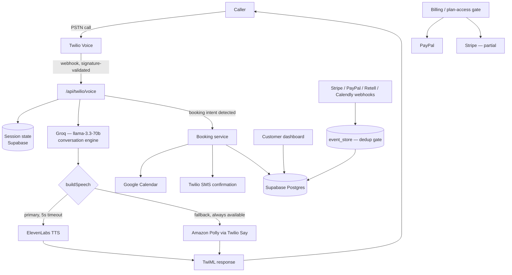

<title>RingDesk AI</title>

# RingDesk AI

AI phone receptionist SaaS for small businesses — answers inbound calls 24/7, books appointments, sends SMS confirmations, and syncs to Google Calendar. Live production product at **[ringdesk.net](https://ringdesk.net)** with real paying customers.

> This repository is a **case study**, not the production codebase. RingDesk's real source, infrastructure, and credentials stay private — see [Why a case study, not source](#why-a-case-study-not-source) below.

## The problem

Small local businesses (dentists, HVAC/plumbing, salons, law firms, real estate) lose revenue every time a call goes unanswered — after hours, mid-appointment, or during peak volume. Hiring a human receptionist or outsourced call center is expensive and doesn't scale down to a single-location business.

## The solution

RingDesk answers every inbound call with a low-latency AI voice agent that sounds natural, understands intent, books real appointments straight into the business's calendar, and texts a confirmation — all without a human ever picking up.

## Who it's for

Single-location and small multi-location service businesses that live or die by phone bookings: dentists, HVAC/plumbing contractors, salons and spas, law firms, real estate agents, hotels, restaurants, insurance agencies, auto services.

## Key features

- **Inbound AI receptionist** — answers every call, handles natural conversation, detects booking intent
- **Outbound AI calling** — proactive follow-up / lead-qualification calls
- **Appointment booking** — books directly into the business's calendar, texts an SMS confirmation
- **Live call dashboard** — call history, transcripts, recordings, lead capture
- **Multi-tenant SaaS billing** — plan-gated features (Starter / Growth, with an internal Pro tier), usage-based minute tracking
- **Admin support tooling** — audit-logged "view as customer" support mode
- **Growth Intelligence** — lead + revenue analytics dashboard
- **Campaign tooling** — outbound calling campaigns (Growth-plan gated)

## Architecture

See [`docs/architecture.md`](docs/architecture.md) for the full system breakdown, [`docs/ai-call-flow.md`](docs/ai-call-flow.md) for the turn-by-turn voice pipeline, and [`docs/integrations.md`](docs/integrations.md) for every third-party integration.

## Technology stack

**Frontend:** Next.js 14 (App Router), TypeScript, Tailwind CSS + custom CSS design tokens
**Backend:** Next.js API routes (Node.js), Supabase (Postgres + Auth)
**AI:** Groq (`llama-3.3-70b`) for live conversation, OpenAI for call-summary/intent classification, Retell AI as the primary voice orchestration layer with a Twilio-TTS fallback path
**Voice:** ElevenLabs (TTS synthesis) → Amazon Polly (guaranteed fallback), Deepgram (speech-to-text)
**Telephony:** Twilio (inbound/outbound calls, SMS)
**Billing:** PayPal (primary, live, in-app checkout — no redirect), Stripe (card checkout, partially configured)
**Calendar:** Google Calendar sync, Calendly webhook integration
**Comms:** Resend (transactional email), Telegram (internal alerting)
**Monitoring:** Sentry, an in-house Watchdog observability system
**Deployment:** Vercel

## Engineering highlights

Full writeup in [`docs/engineering-highlights.md`](docs/engineering-highlights.md). In short:
- **Never-silent voice pipeline** — a hard 3-tier TTS fallback chain (ElevenLabs → Polly → hardcoded safety text) means a caller is never met with dead air, even if a third-party provider is down
- **Idempotent webhook processing** — every inbound webhook (Stripe, PayPal, Retell, Twilio, Calendly) goes through a dedup gate (`event_store`) keyed on provider-native event IDs before any database mutation
- **Stateless call sessions** — call state is never held in process memory (serverless functions are cold-start-destroyed); every turn persists to Postgres
- **Tenant isolation enforced at the data layer** — every write that touches user data must carry a resolved `user_id`, enforced through two dedicated guard modules rather than ad hoc checks
- **Single billing gate** — one function (`lib/plan-access.ts`) is the only place plan/feature access is decided, specifically to prevent the classic SaaS bug of two billing checks drifting out of sync

## Project status

**Production** — live at [ringdesk.net](https://ringdesk.net) with paying customers.

## My role

I designed and built RingDesk AI end-to-end: the voice pipeline (Twilio + Retell + Groq + ElevenLabs/Polly fallback), the multi-tenant SaaS billing system (PayPal-first, in-app checkout), the booking/calendar integration, the customer dashboard, and the operational tooling (Watchdog monitoring, admin support mode, event-dedup webhook infrastructure).

## What I learned

Building a phone system that real businesses depend on for revenue forced a different engineering discipline than a typical CRUD SaaS: every voice-pipeline change had to preserve the fallback chain and sub-4-second turn latency, every webhook had to be idempotent because telephony providers retry aggressively, and every billing check had to live in exactly one place because a single drifted gate means either blocking a paying customer or leaking a paid feature for free.

---

## Why a case study, not source

RingDesk is a live production system with real customer data flowing through it. Publishing its actual source would mean publishing internal API routes, database schema details, and infrastructure specifics that aren't appropriate to expose publicly — independent of the credential-hygiene cleanup already in progress internally. This repository documents the architecture, the engineering decisions, and the problem it solves, without shipping the underlying code.
