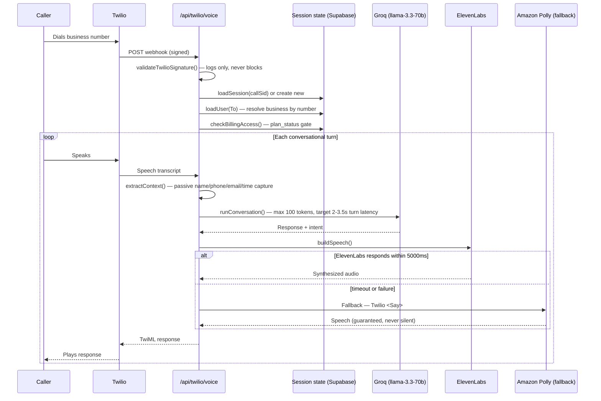

# RingDesk AI — Call Flow

## Inbound call, turn by turn

## Booking sequence

1. The AI detects booking intent mid-conversation and switches to "closer" agent mode.
2. Before the `book` action can fire, the caller's full name is required — if missing, the system asks for it explicitly rather than booking anonymously. This is enforced in code, not just prompted for.
3. On `book`: appointment time is extracted from the AI's message, `finalizeCall()` sends the SMS confirmation, creates the Google Calendar event, and logs usage minutes.
4. `session.callRecordId` is set to `null` immediately after booking to prevent the call record from being finalized twice if the conversation continues ("anything else I can help with?").
5. On hangup/goodbye detection, the call ends with a spoken sign-off.

## Why the fallback chain matters

The TTS path is ElevenLabs → Amazon Polly → a hardcoded safety text string, in that order, with a hard 5-second timeout on the primary provider. A caller is a potential paying customer for the business RingDesk represents — dead air on a phone call is the one failure mode that's worse than a slightly-less-natural voice, so the fallback exists specifically to make total silence structurally impossible rather than just unlikely.

## Outbound calling

A separate path (`/api/twilio/outbound`) initiates proactive calls — used for lead follow-up and campaign-driven outreach. Outbound sessions are tracked in a dedicated `outbound_sessions` table (rather than in-process memory, since serverless functions are stateless across invocations) and cleaned up on call completion.
