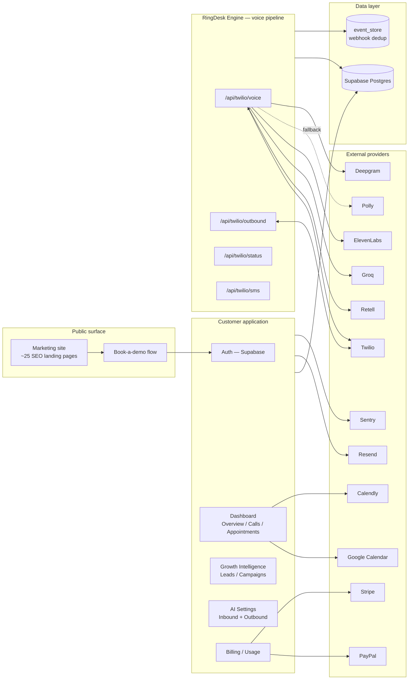

# RingDesk AI — Architecture

## System overview

RingDesk is a multi-tenant Next.js SaaS application. Every business ("account") owns one or more phone numbers; every inbound or outbound call is scoped to that account's `user_id` at every database write.

## Module boundaries

The codebase enforces a strict separation between HTTP concerns and business logic:

- **`app/api/`** — HTTP adapters only. Parse the request, validate auth, call into `lib/`, return a response. No business logic lives here.
- **`lib/`** — pure business logic. No Next.js imports, no `Request`/`Response` types — this is what makes the core logic testable independent of the HTTP layer.
- **`lib/processors/`** — webhook event handlers. Always invoked through the `event_store` dedup gate, never called directly.
- **`lib/watchdog/`** — observability only. May read the database for monitoring purposes but must never write to business tables — a deliberate constraint to keep monitoring from ever becoming a source of data corruption.
- **`lib/deploy/`** — deployment lifecycle, isolated from the runtime call path so a deploy-time concern can never affect a live call.

## Data access pattern

All database access goes through exactly two entry points in `lib/db.ts`:
- `systemScoped()` — for crons and system-level operations
- `userScoped(id)` — for anything scoped to a single tenant

Direct admin-client calls are banned everywhere else in the codebase; `lib/supabase.ts` owns the single Supabase admin client singleton that every other module imports from. This is a deliberate constraint to make tenant-isolation bugs structurally harder to introduce — there's exactly one place a "did I forget to scope this query by user?" bug could hide.

## Webhook idempotency

Every inbound webhook (Retell, Twilio, Stripe, Calendly) is authenticated first (signature/HMAC verification per provider), then passed through `writeEvent()` before any database mutation. A duplicate event (same provider-native event ID) returns HTTP 200 immediately with no side effects — this is what makes the system safe against the aggressive retry behavior telephony and payment providers exhibit under any latency or transient failure.

## Billing access control

A single field, `plan_status`, gates every paid feature, checked through one function (`lib/plan-access.ts`). Allowed states: `active`, `trialing`, `approved`, `approval_pending`. Everything else is blocked. This single-gate design exists specifically to prevent the common SaaS failure mode where two independent billing checks drift out of sync — one blocking a paying customer, the other leaking a feature for free.

## Deployment

Vercel, with a required pre-deploy sequence: TypeScript type-check (zero errors required) → ESLint → `next build` → manual approval → `vercel --prod`. The type check is never skipped — a broken build on this codebase means live calls fail.
